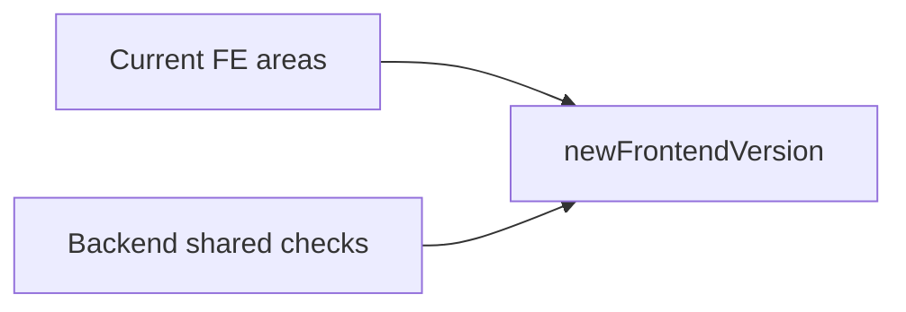

# Decompose the frontend assessment template

## What is wrong now

[templates/frontendCurrentVersion_05.11.26.json](templates/frontendCurrentVersion_05.11.26.json) has 14 areas and 86 tasks. Many descriptions are one-liners (“Validate and sanitize all user-provided data”), and several tasks grade more than one thing at once (Jira and Slack as one integration, env vars and secrets together, SOLID and KISS together, two overlapping CI/CD pipeline tasks, rollback mixed with staged rollout). A few items are stuck on React Native wording (Detox, Sentry RN, hit-slop, the RN compatibility matrix) inside a general Front-end template.

[templates/backendCurrentVersion_05.11.26.json](templates/backendCurrentVersion_05.11.26.json) is the bar to copy from: 9 areas, 95 tasks, and every description ends in an auditable **DONE only if** list. Dead code is only a clause inside “KISS: no over-engineering” (“no dead configurability, unused extension points”). That check gets its own frontend task, and the other backend checks that frontend never states explicitly come with it.

## Deliverable

Write only [templates/newFrontendVersion.json](templates/newFrontendVersion.json). Do not change the CSV, the assessment skill, or the two source templates.

Shape: a JSON array of areas, same idea as the backend export, without server identity or personal data (no ids, timestamps, owner email, `__entity`). Each area has `title`, `position`, and `tasks`. Each task has `body`, `description`, `risk`, `position`, and `comments` (only real reference links, `{ "comment": "<url>", "type": "LINK" }`).

Writing rules, taken from the backend voice:

- Description states the check, then `DONE only if:` with evidence someone can point at in the repo, CI, or project space.
- Risk is one short paragraph about delivery or user impact, not a bullet list.
- Shared checks keep the backend pass bar, with FE nouns swapped in (FE developer, client bundle, browser storage).
- Conditional checks say `Applies only if ...; applicability is declared at kickoff.` so one template still covers web and React Native.
- Tasks do not double-grade the same evidence. Where two current items overlap, one task owns the pass bar and the other is dropped or narrowed.

## Area map

Nine areas, about the same size as the backend template.

### 0. Kick-off

Shared, from backend, lightly renamed: stakeholder register, client channel, FE channel and recurring sync when there is more than one FE developer, WBS versus team commitment, branching model (branch names, commits, and tags in one document; machine enforcement is graded later), Jira integration, Slack integration, IDE setup as committed config, package registry when private packages exist.

Kept from the current frontend file, rewritten with a pass bar: internal response times and escalation (the half of “Communication channels setup” that the client-channel task does not cover), Jira validators that block the testing column until root cause and affected area are filled, estimation approach, Cursor usage versus the stream average.

New FE analog of backend “choose boilerplate and compute platform”: record the UI platform and starter (SPA, SSR, React Native, and so on) and show the repo matches that choice.

Dropped as separate tasks because they move or merge: “Useful Links” and “Stakeholder register” leave Documentation / Jira and land in Kick-off or Documentation with the backend criteria. Git tags and commit-message rules stop being their own tasks; the document is here, enforcement is the conventions gate.

### 1. Delivery Workflow and Environments

From backend: AI rules committed and current, code review with branch protection and real review activity (PR comments staying on the PR is part of this, not a second task), conventions gate (lint, format, and commit messages fail the hook or CI; warn-only does not pass), release runbook, rollback that has actually been exercised, safe or staged rollout as its own task, env-specific config with no hardcoded environment URLs, code ownership when there is more than one FE developer.

Split the two overlapping pipeline tasks into “CI builds and tests on every change” and “deployment pipeline to staging and production”.

Split “Cursor setup: rules, Figma MCP, new features” into the shared AI-rules task plus a frontend-only “design context connected” task (Figma MCP or the project’s equivalent).

Keep AI PR review as its own task. It is a different control from local Cursor rules.

Local setup is adapted, not copied: a clean checkout reaches a running app from the documented commands. Docker Compose is required only when the frontend needs backing services, not for every SPA.

### 2. Architecture and Code Quality

Promote dead code out of the KISS sentence into its own task. Pass only if unused files, exports, routes, and dependencies are detected with a real tool (knip, ts-prune, depcheck, or an equivalent lint-plus-dependency run), the run is in CI or recorded, and findings are zero or ticketed. KISS stays about speculative abstractions and dead extension points, so the two can fail separately.

Also take these backend checks, rewritten for UI code: size and single responsibility of components, hooks, and modules; structural duplication (Sonar density or a file spot-check); dependency direction and no cross-feature reach-ins; library currency, one library per job, and peer compatibility as one task (replaces four overlapping stack items); supported framework, Node, and TypeScript versions with a migration plan before EOL.

Frontend checks rewritten so each has one failure mode:

- composition and hooks rather than inheritance
- effect, subscription, and request cleanup
- UI separated from domain rules and side effects, judged from the code rather than folder names
- TypeScript strict mode and `tsc` in CI
- route-level code splitting and tree-shaking
- hot-path render cost (virtualization, stable props, no request waterfalls)
- client request timeouts, bounded retries, and cancel on unmount
- duplicate submits blocked on payments, orders, and similar actions, only when the UI triggers those side effects
- expedient patterns (strategy, factory, and so on) only where variation is real

“SOLID, KISS, and other best practices” is removed as a bundle. SRP and dependency direction cover the part that can be audited.

### 3. UI kit and accessibility

Keep the current UI-kit area, but make each item fail independently:

- primitives come from one kit (custom or adopted)
- customization is props and variants, with a consistent API
- theme or design tokens are the only source of shared visual values
- stories (or an equivalent) show props, variants, and states and match the components
- kit components have names, roles, keyboard use, and focus order (hit-slop only if the platform is native)
- an automated check exists (jsx-a11y, axe, or Storybook a11y)
- expensive kit components document how they avoid extra renders

App-wide bundle and route performance stay in Architecture, not here.

### 4. State and server cache

Replace the ten slogans. The current “Context instead of prop drilling” item is rewritten: state stays near its use, and context is only for state that is truly shared, not a second global store.

- server cache and UI state use different mechanisms
- cache contents are limited to what screens render
- mutations invalidate or update the affected entries
- loading, empty, and error are explicit, and stale data is not shown as fresh
- updates are immutable
- derived values are computed, not stored
- one client store and one server-cache library, unless a written exception exists

### 5. Security and Compliance

Replace the ten short security lines with evidence checks. General ones copied from backend: no secrets in the tree or git history (scanner over history, plus a continuous hook or CI); secrets in config are references, not literals; automated dependency scanning; a real patch process with an owner and an example of it having run; SAST gating CI; least privilege for FE engineers; third-party services owned by the organization; license scan with no unexplained GPL/AGPL; no tokens, PII, or secrets in logs and the error tracker.

Frontend-only:

- private keys never ship in the client bundle or `NEXT_PUBLIC_` / `VITE_` variables
- browser storage does not hold tokens or personal data
- no unsafe HTML or `eval` of user content
- CSP, frame protection, and Referrer-Policy as three checks
- session handling fails closed (expiry, logout clears the credential)
- production has no public source maps, Storybook, or verbose errors
- HTTPS only, no mixed content
- user-facing errors stay generic

“Audit dependencies regularly”, “encrypt data at rest”, and “compartmentalize if possible” are dropped as slogans; their real content sits in the tasks above. Licensing moves here from Documentation, matching backend.

### 6. Testing and Quality Gates

Align with the backend split so “we have Jest” cannot pass coverage by itself:

- SonarQube on the Geniusee server, on the branch people actually use, with coverage and duplication filled in
- framework plus a written coverage expectation (80% unless kickoff agreed otherwise)
- a blocking coverage gate
- FE-owned unit and component tests that exercise behavior, not just snapshots
- snapshot tests kept small and reviewed
- E2E of critical flows in the FE pipeline; Playwright, Cypress, or Detox is acceptable once the platform is declared. Android-and-iOS Detox is no longer the definition of the check.

### 7. Observability

The current area is only two Sentry lines, and both say “Sentry RN”. Replace with:

- client error tracking with environment, release, and uploaded source maps
- performance signals (Web Vitals or tracing) collected and actually looked at
- render errors and unhandled rejections are captured
- client errors can be tied to a backend request when the API returns a correlation id

Server health, database metrics, and structured server logs stay out. Those are backend checks.

### 8. Documentation and Knowledge

Use the backend split. Current “Architecture overview and decisions” becomes an ADR log plus a current diagram. Current four tech-debt tasks become one evidence task: tickets exist, recent iterations closed some, and debt seen in the code is in the backlog. Same treatment as backend, because four process slogans can all pass while nothing is fixed.

Also: minimum doc set (run, architecture, deploy, integrations), README that actually boots the app, JSDoc/TSDoc on public and non-obvious code, cookbook that new code follows, measurable NFRs (include a Core Web Vitals and accessibility target), risk register judged by its contents, useful links that resolve and that point at credential locations rather than secret values, onboarding and offboarding checklists.

## Links

Keep Geniusee wiki links and canonical references that still match the task (contribution guidelines, conventional commits, Sonar quality gates, semver, CSP, Storybook, Cursor rules). Drop links that define the wrong platform: Google Play staged rollout, Detox as the E2E standard, `reactnative.dev` TypeScript, Bitrise secrets. Do not copy commenter names or ids.

## Check after writing

Parse the file, and confirm every task has a non-empty risk and a `DONE only if` description, positions are contiguous per area, and task bodies are unique.